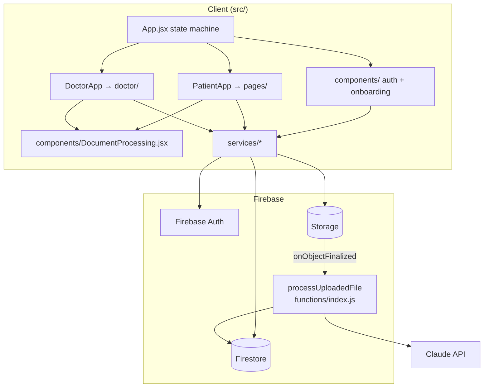
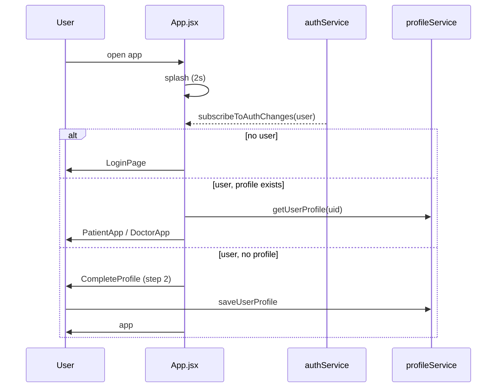
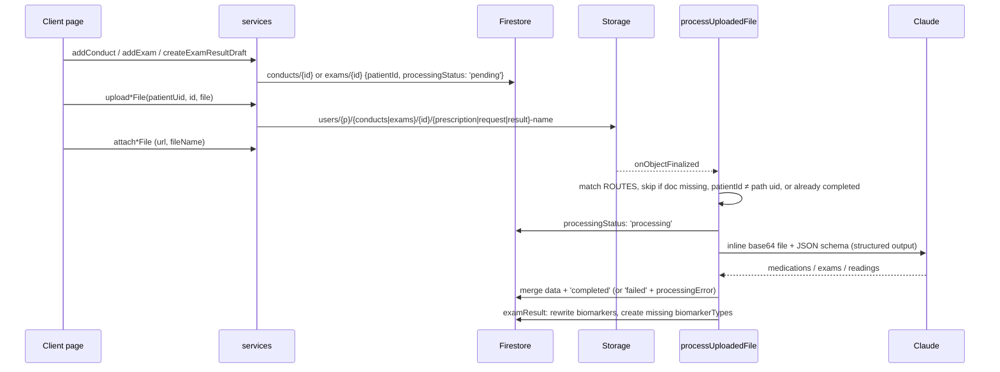

# Codebase Map

> Auto-generated by Cartographer. Last mapped: 2026-10-03T21:17:58Z (token counts are approximate, bytes/4)

Brazilian patient/doctor health-tracking PWA (despite the "Tamagotchi" name). React 19 + Vite + MUI client on Firebase (Auth, Firestore, Storage, Hosting), plus one Cloud Function that uses Claude to extract structured data from uploaded medical documents. UI strings, Firestore enum values and prompts are in Portuguese.

## System Overview



## Directory Structure

```
.
├── CLAUDE.md, README.md        # README is Vite boilerplate + leftover bootstrap prompt
├── package.json                # client deps (react-router-dom installed but unused)
├── vite.config.js              # React + VitePWA (manifest, brand colors)
├── eslint.config.js
├── index.html
├── firebase.json               # PROD: firestore/storage rules, hosting (dist/, SPA rewrite), functions
├── firestore.rules, storage.rules  # security rules (used by prod and the emulators)
├── firebase.local.json         # EMULATORS ONLY (auth 9099, functions 5001, firestore 8080, storage 9199, UI 4000)
├── .firebaserc                 # project tamagotchi-459a6
├── public/                     # icons
├── functions/                  # Cloud Function (CommonJS, Node 20)
│   ├── index.js                # processUploadedFile: Storage trigger → Claude → Firestore
│   ├── .env                    # EXTRACTION_MODEL override
│   └── scripts/simulate-upload.js  # local end-to-end test against emulators
└── src/
    ├── main.jsx                # entry
    ├── App.jsx                 # auth/onboarding state machine + PatientApp/DoctorApp
    ├── firebase.js             # hard-coded Firebase config; exports app, auth, db
    ├── components/             # auth/onboarding screens + shared DocumentProcessing
    ├── pages/                  # patient screens
    ├── doctor/                 # doctor screens
    ├── services/               # ALL Firestore/Storage/Auth access
```

## Module Guide

### App shell

| File | Purpose |
|------|---------|
| `src/main.jsx` | `ThemeProvider` + `CssBaseline` + `ToastProvider` around `App` |
| `src/theme.js` | MUI theme + `colors` tokens + `cardShadow`, `APP_MAX_WIDTH` (520) |
| `src/App.jsx` | Stage state machine; local `PatientApp`, `DoctorApp` |
| `src/firebase.js` | Exports `firebaseApp`, `auth`, `db`, `storage`; `VITE_USE_EMULATORS=true` switches to `demo-tamagotchi` + local emulators |
| `src/index.css` | Page frame only (centered 520px column) |

**Stage machine:** `splash` (only while auth resolves) → `login` → [`forgotPassword` | `createAccount` (step 1) → `completeProfile` (step 2)] → app.
- `subscribeToAuthChanges`: user with a profile → app; user without a `users/{uid}` doc → `completeProfile`; no user → `login`.
- Step 1 hands App a `signupDraft` (role, name, e-mail) before creating the account, because the auth listener switches to step 2 as soon as the user exists. Without a draft (first Google/Apple login) step 2 shows the role choice.
- `role === 'doctor'` → `DoctorApp`, otherwise `PatientApp`.

**PatientApp** tabs (`BottomNav`): `saude` → HealthPage · `evolucao` → EvolutionPage · `plano` → PlanPage · `equipe` → TeamPage (badge = incoming link requests). The "Enviar exame" FAB (on Saúde and Plano) opens `UploadExamSheet`. Sub-screen: `openRisk` → RiskPage. Tapping a change tile on Saúde opens Evolução focused on that biomarker.

**DoctorApp** tabs: `inicio` → DoctorHomePage · `pacientes` → PatientsListPage (badge = incoming link requests) · `exames` → ExamesPage (badge = results to review). `openPatient` → PatientDetailPage (the per-patient hub), which opens SendPrescriptionPage / RequestExamPage. DoctorApp owns the one live `subscribeToDoctorExamReviews` subscription and passes `reviews` down.

### components/ (shared UI, auth, onboarding)

| File | Purpose |
|------|---------|
| `ui.jsx` | Building blocks: `PersonAvatar` (initials, color from name), `Pill`, `RiskIcon`, `Page`, `PageHeader`, `Section`, `GroupLabel`, `TextAction`, `RowButton` (plain row without onClick), `EmptyState`, `BottomNav`, `Segmented`, `ChoiceChips` (single or multi), `FieldLabel`, `BottomSheet`, `ActionBar`, `Sparkline` |
| `uiHelpers.js` | `initialsOf`, `TONES` (good/warn/alert/info/brand/neutral), `changeTone`, `changeLabel` |
| `Toast.jsx` / `toastContext.js` | `ToastProvider`; `useToast()(message, { action: { label, onClick } })` (used for "Desfazer") |
| `AccountMenu.jsx` | Avatar button → menu with who is signed in and "Sair" |
| `FileField.jsx` / `fileRules.js` | File chip / attach button; `validateFile` (PDF/PNG/JPEG, 14 MB — same limits as the function and storage.rules) |
| `DocumentProcessing.jsx` | `ProcessingStatusChip({status})`, `ExtractedDataPanel({item})`; maps `processingError` codes to messages |
| `SplashScreen.jsx` | Logo + spinner while auth resolves |
| `LoginPage.jsx` | E-mail/password (show/hide), Google, Apple. Navigation happens through the auth listener |
| `CreateAccountPage.jsx` | Step 1: role, name, e-mail, password with strength bar. Also exports `RoleChoice`, `StepProgress` |
| `CompleteProfilePage.jsx` | Step 2: role-specific profile (role choice when no draft); "Sair" signs out |
| `ForgotPasswordPage.jsx` | Reset e-mail; shows "Confira seu e-mail" even on error (anti-enumeration, intentional) |

### pages/ (patient)

| File | Purpose | Services |
|------|---------|----------|
| `HealthPage.jsx` | Hub: high-risk banner, risks (low ones collapsed), 3 most recent biomarker changes (tap → Evolução), next pending conduct with "Feito" (live) | `getLatestRisks`, `getBiomarkersGrouped`, `getBiomarkerTypes`, `computeChange`, `subscribeToConducts`, `setConductDone` |
| `EvolutionPage.jsx` | Period switch, Recharts area chart of the focused biomarker, list of all biomarkers with sparkline and trend over the period | `getBiomarkersGrouped`, `getBiomarkerTypes` |
| `PlanPage.jsx` | One list by period (conducts by `timeframe`, exam requests bucketed by date), tap circle = done (undo toast), rows expand to why/attachment/extracted data; "Resultados enviados" | `subscribeToConducts`, `subscribeToExams`, `setConductDone` |
| `TeamPage.jsx` | Incoming requests (Aceitar/Recusar), doctors, pending invites, other caregivers (call button); "Adicionar" sheet: invite a doctor or add a family/caregiver contact | `getPatientCareLinks`, `getCareContacts`, `addCareContact`, link fns, `listDoctors` |
| `UploadExamSheet.jsx` | Bottom sheet: photo or file first, doctor pre-selected when there is one, category chips, optional name (defaults from the file name). `saving → uploading` with progress | `getPatientCareLinks`, `createExamResultDraft`, `uploadExamResultFile`, `attachExamFile`, `markExamUploadFailed` |
| `RiskPage.jsx` | One risk type: current value, inputs used, earlier calculations, model | `getRiskHistory`, `getBiomarkerTypes` |

### doctor/

| File | Purpose | Services |
|------|---------|----------|
| `DoctorHomePage.jsx` | Tappable stats (to review / high risk / link requests), first results to review, high-risk alerts | `getDoctorPatients`, `getLatestRisksForPatients` (+ `reviews` prop) |
| `ReviewCard.jsx` | A submitted result: patient, status, extracted values, "Arquivo", "Marcar como revisado" (undo toast). Used on the dashboard, Exames and the hub | `setExamReviewed` |
| `ExamesPage.jsx` | Category switch, results to review, reviewed list (tap → patient) | `groupByReviewStatus`, `filterByCategory` (+ `reviews` prop) |
| `PatientsListPage.jsx` | Search, "Precisam de atenção" filter (result to review or high risk), incoming requests, invite sheet. N+1 `getUserProfile` for ages, on purpose | `getDoctorPatients`, `getLatestRisksForPatients`, link fns, `listPatients`, `getUserProfile` |
| `PatientDetailPage.jsx` | Patient hub: "Enviar receita" / "Pedir exame", results to review, risks, indicators, active plan, requested exams, past results (live exams/conducts) | `getUserProfile`, `subscribeToExams`, `subscribeToConducts`, `getBiomarkersGrouped`, `getBiomarkerTypes`, `getLatestRisks` |
| `SendPrescriptionPage.jsx` | Optional file, type chips, title, timeframe (also sets the due date: 7/90/365 days or none for "Contínuo"), "Por quê?" | `addConduct`, `uploadConductPrescriptionFile`, `attachConductFile`, `markConductUploadFailed` |
| `RequestExamPage.jsx` | Multi-select common exams + custom ones, priority, deadline, optional signed request. Creates ONE exam doc titled with all chosen exams | `addExam`, `uploadExamRequestFile`, `attachExamFile`, `markExamUploadFailed` |

### services/

| File | Exports | Tokens |
|------|---------|--------|
| `authService.js` | `loginWithEmail`, `registerWithEmail({fullName,email,password})`, `loginWithGoogle`, `loginWithApple`, `resetPassword`, `logout`, `subscribeToAuthChanges` | 412 |
| `profileService.js` | `saveUserProfile(uid, data)`, `getUserProfile(uid)` | 148 |
| `careTeamService.js` | careLinks: `careLinkId`, `requestPatientDoctorLink({patientUid, patientProfile, doctorUid, doctorProfile, initiatedBy})`, `confirmPatientDoctorLink(p, d)`, `declinePatientDoctorLink(p, d)`, `unlinkPatientAndDoctor`, `getPatientCareLinks`, `getDoctorPatients`, `subscribeToIncomingRequestsForPatient/ForDoctor`. careContacts: `getCareContacts`, `addCareContact`, `removeCareContact` | 1200 |
| `conductsService.js` | `getConducts(patientId)`, `subscribeToConducts(patientId, cb, onError)`, `getNextPendingConduct`, `addConduct(patientId, c)`, `markConductDone(id)`, `attachConductFile(id, …)`, `markConductUploadFailed(id)`, `groupByTimeframe`, re-exports `formatRelativeDate` | 850 |
| `examsService.js` | `toExam`, `getExams(patientId)`, `subscribeToExams`, `addExam(patientId, e)` (default `kind: 'request'`), `updateExamStatus(id)`, `attachExamFile(id, …)`, `markExamUploadFailed(id)`, `groupByStatus`, re-exports `formatRelativeDate` | 850 |
| `examReviewService.js` | `createExamResultDraft` (exam with `kind: 'result'`), `markExamReviewed(examId)`, `getDoctorExamReviews`, `subscribeToDoctorExamReviews`, `getPatientIdsWithPendingReview`, `groupByReviewStatus`, `filterByCategory` (missing category → `documento`) | 900 |
| `biomarkersService.js` | `getBiomarkerTypes()` (map by key), `saveBiomarkerType`, `addBiomarker(patientId, …)`, `getBiomarkersGrouped(patientId)`, `getLatestAndPrevious`, `computeChange(readings, goodDirection)` | 750 |
| `risksService.js` | `RISK_TYPES`, `RISK_CATEGORIES`, `riskTypeLabel`, `formatRiskValue`, `getLatestRisks(patientId)`, `getRiskHistory(patientId, riskType)`, `getLatestRisksForPatients(ids)` (one query per patient, for the rules), `addRisk` | 950 |
| `storageService.js` | `uploadConductPrescriptionFile`, `uploadExamRequestFile`, `uploadExamResultFile` (all `(patientUid, id, file, onProgress)` → `uploadBytesResumable` + `getDownloadURL`) | 378 |
| `userDirectoryService.js` | `listDoctors`, `listPatients` (query `users` by role, no pagination) | 204 |
| `dateUtils.js` | `formatRelativeDate` ("Atrasado", "Hoje", "Em X dias/meses/anos") | 133 |
| `demoData.js` | Plain sample data + `monthsAgoDate`/`daysFromNow`; imported by both seeders | 1300 |
| `seedDemoData.js` | `seedAllDemoData(uid)`: biomarkerTypes, biomarkers, risks (demo values), careContacts, exams, conducts; console-only, not idempotent | 1700 |

### functions/

| File | Purpose | Tokens |
|------|---------|--------|
| `index.js` | `processUploadedFile` Storage trigger (secret `ANTHROPIC_API_KEY`, 1GiB, 540s) | 3553 |
| `scripts/simulate-upload.js` | Creates the pending doc exactly like the client, uploads to the emulator, waits for the result and prints it | 1357 |
| `package.json` | `@anthropic-ai/sdk`, `firebase-admin`, `firebase-functions`; scripts `emulators`, `simulate` | 123 |

## Firestore Data Model

Every collection is at the root. Relationships are id fields, never nesting.

| Collection | Doc id | Key fields |
|------|------|-----------|
| `users` | auth uid | `role: patient\|doctor`, `fullName, email, phone, dateOfBirth, cpf, country, cityState`; patient: `sexAssignedAtBirth, genderIdentity`; doctor: `crm, crmState, specialty, rqe` |
| `careLinks` | `{patientId}_{doctorId}` | `patientId, doctorId, status (pending\|confirmed), initiatedBy (patient\|doctor), createdAt, confirmedAt`, display copies `patientName, doctorName, doctorSpecialty, doctorCrm` |
| `careContacts` | auto | `patientId, name, memberType (nurse\|family), phone, specialty, relationship` |
| `conducts` | auto | `patientId, title, why, timeframe (agora\|proximos90\|esteAno\|longoPrazo), type (medication\|diet\|exercise\|followup), dueDate, status (pending\|done)`; optional `doctorId, doctorName, attachmentUrl, attachmentFileName, processingStatus, processingError, processedAt, medications[{name,dosage,instructions}]` |
| `exams` | auto | `patientId, kind (request\|result), title, status (solicitado\|em_andamento\|realizado), priority (prioritario\|rotina), scheduledDate, category (laboratorial\|imagem\|documento), icon`; optional doctor/attachment/processing fields, `requestedExams[{name,notes}]`; results also `patientName, submittedAt, reviewStatus (not_reviewed\|reviewed), extractedValues[{biomarkerType,label,value,unit}]` |
| `biomarkerTypes` | key (`ldl`, `sbp`, `egfr`…) | `label, unit, goodDirection (down\|up, optional)`; function-created also `createdBy: 'extraction'` |
| `biomarkers` | auto, or `{examId}_{i}` from the function | `patientId, biomarkerType, value, unit, recordedAt, source (exam\|manual), examId` |
| `risks` | auto (one per calculation) | `patientId, riskType (cardiovascular\|diabetes\|metabolico\|oncologico\|cerebral), value (%, nullable), category (baixo\|moderado\|alto), model, horizonYears, inputs {biomarkerType: value}, calculatedAt` |

**Queries are equality-only** (`where(field, '==', …)`, `in`) and sorted in memory, so Firestore serves them from automatic single-field indexes and no `firestore.indexes.json` is needed.

**No mirrored copies.** A patient-submitted exam result is one `exams` doc with both `patientId` and `doctorId`; the doctor's review queue is `exams where doctorId == me and kind == 'result'`. "Patient has something to review" is computed from that query (`getPatientIdsWithPendingReview`), not stored.

**Risks are not calculated anywhere yet.** Only `seedDemoData` writes them (demo values). Calculators (PREVENT, Framingham…) are a separate step.

## Data Flow

### Auth / onboarding



### Document upload → AI extraction



**Pipeline details** (`functions/index.js`):
- `ROUTES` (must match `storageService.js` prefixes): `/^users\/([^/]+)\/conducts\/([^/]+)\/prescription-/`, `/^users\/([^/]+)\/exams\/([^/]+)\/request-/`, `/^users\/([^/]+)\/exams\/([^/]+)\/result-/`.
- Gate: PDF/PNG/JPEG only, ≤14 MB (base64 stays under the 32 MB API limit). Failures here skip Claude: `unsupported_type` / `file_too_large`.
- Model: `EXTRACTION_MODEL` param (default `claude-opus-5`, set in `functions/.env`), `max_tokens: 16000`, `output_config.format` JSON schema (`MEDICATIONS_SCHEMA`, `REQUESTED_EXAMS_SCHEMA`, `LAB_RESULTS_SCHEMA`), server-side fallback beta. `refusal` / `max_tokens` stop reasons throw.
- The doc is `{conducts|exams}/{id}` at the root; it must exist and its `patientId` must equal the uid in the Storage path.
- examResult: known `biomarkerTypes` are put in the prompt so the model reuses existing keys (the schema field is still called `metricKey`; it is stored as `biomarkerType`). `safeMetricKey` (`^[a-zA-Z][a-zA-Z0-9]{0,39}$`, else slugify the label). `collectedOn` is validated (no dates >24h in the future, else now). Previous `biomarkers` `where examId ==` are deleted before the new ones are written.
- Every thrown error becomes `extraction_failed`. The real message goes only to Cloud Logging.
- `processingError` codes: `upload_failed` (client), `file_too_large`, `unsupported_type`, `extraction_failed`.

**Local testing:** `cd functions && npm run emulators` (project `demo-tamagotchi`, Auth included), `npm run seed` (resets the emulators, creates `local-patient` / `local-doctor` logins with password `local123` plus `demoData.js`), then `npm run simulate -- examResult file.pdf`. `npm run dev:emulators` at the root runs the app against the emulators (`src/firebase.js` switches project id and connects Auth/Firestore/Storage). The script forces the emulator host env vars before loading `firebase-admin` and uses fixed uids `local-patient` / `local-doctor`.

## Conventions

- No router: the stage/section is a string in state, and sub-screens early-return on local state.
- Components never touch Firestore directly. Every data access goes in `src/services/`.
- Styling: MUI theme in `src/theme.js`; colors only through its `colors` tokens; screens built from `components/ui.jsx`. MUI v9: `slotProps`, not `InputProps` / `inputProps` / `PaperProps`.
- Forms use functional state updates (`setForm((f) => …)`), so handlers created in an earlier render (e.g. a select menu's) don't write back stale values.
- Successful actions confirm with a toast; reversible ones (done, reviewed) offer "Desfazer".
- Live lists use `subscribeTo*(uid, cb, onError)` (onSnapshot). One-off reads use `get*`.
- `group*` / `filter*` helpers in services shape the data for the UI.
- Relationships are `patientId` / `doctorId` fields on root collections; queries are equality-only and sorted in memory.
- Client only ever writes `processingStatus: 'pending'` (plus the `mark*UploadFailed` helpers). The function owns the other transitions.

## Gotchas

1. **Unused dependency:** `react-router-dom`.
2. **Two biomarker-type writers:** `functions/index.js` `ensureBiomarkerType` uses `.create()` and never overwrites. `src/services/biomarkersService.js` `saveBiomarkerType` uses `setDoc(merge)`, which overwrites label/unit.
3. Function-written `biomarkers` carry `source: 'exam'` and `examId`; client-written ones carry `source: 'manual'`.
4. **Security rules:** `firestore.rules` / `storage.rules`. Access is checked through `patientId` / `doctorId` and, for doctors, a `get()` on `careLinks/{patientId}_{doctorId}`. That `get()` can't be evaluated over an `in` list, so `getLatestRisksForPatients` runs one query per patient. Any signed-in user can read every `users` profile (the doctor/patient search needs it), which includes CPF and phone.
5. **Not backed by data yet:** appointments (no collection; the doctor Agenda tab was removed) and risk values (seed only). There are no notifications yet.
6. **Stale "Gemini" references:** `functions/package.json` description and the `.gitignore` comment. The code uses Claude.
7. **Missing icons:** the manifest references `icon-512-maskable.png` and `index.html` references `apple-touch-icon.png`, but neither file is in `public/`. The manifest description still says "Your virtual pet".
8. The `src/firebase.js` comment mentions `VITE_FIREBASE_*` env vars, but the config is hard-coded on purpose.
9. `README.md` is Vite boilerplate plus the original bootstrap prompt.
10. ForgotPasswordPage shows success on error on purpose. `PatientsListPage` does an N+1 profile read on purpose ("at this scale").

## Navigation Guide

- **Add a patient screen/tab:** `src/pages/NewPage.jsx` built from `components/ui.jsx`, add it to `PATIENT_TABS` and the `section` cases in `PatientApp` (`src/App.jsx`).
- **Add a doctor screen/tab:** `src/doctor/`, `DOCTOR_TABS` and `DoctorApp` in `src/App.jsx`.
- **Add data access:** a function in the matching `src/services/*Service.js`. If both users need the data, write both trees in one `writeBatch`.
- **Add a new extractable document kind:** a storage path helper in `storageService.js`, a matching `ROUTES` entry + schema + processor in `functions/index.js`, and rendering in `DocumentProcessing.jsx`.
- **Change error messages / status chips:** `src/components/DocumentProcessing.jsx`.
- **Change onboarding/auth:** `src/App.jsx` stage machine, `src/components/*Page.jsx`, `src/services/authService.js` / `profileService.js`.
- **Change the extraction model:** `functions/.env` `EXTRACTION_MODEL`.
- **Add a risk calculator:** write `risks` docs with `addRisk` (or the Admin SDK from a function) and fill `inputs` with the biomarker values used; the UI picks up the newest doc per `riskType`.
- **Seed demo data:** `seedAllDemoData(uid)` from `src/services/seedDemoData.js` in the browser console.
